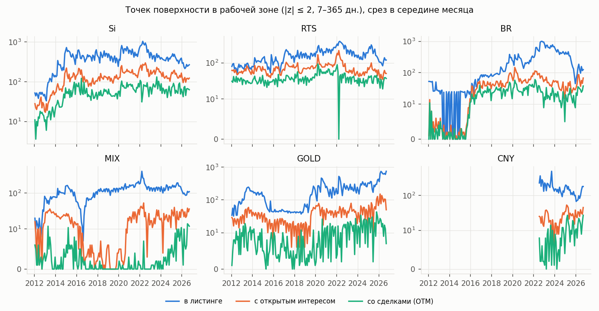
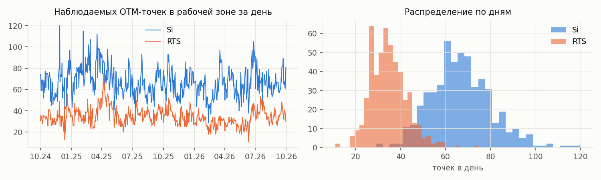
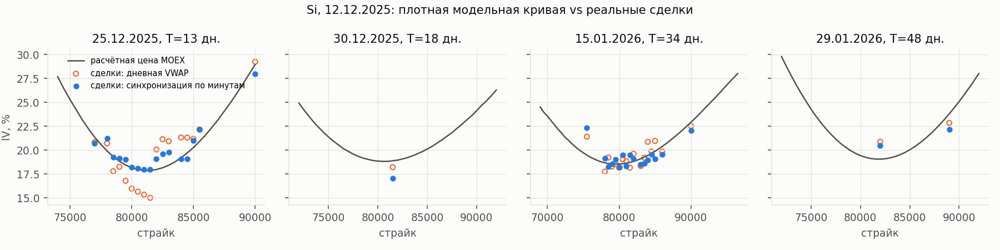
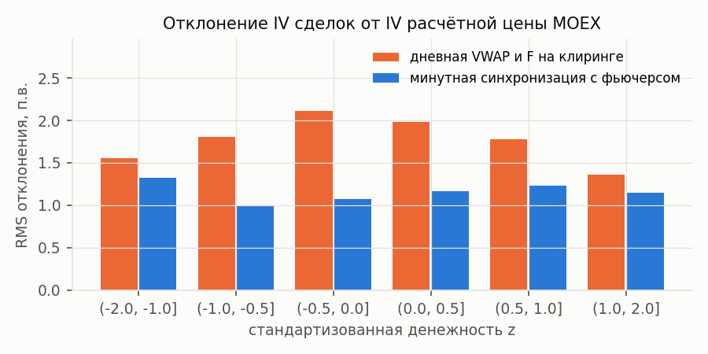
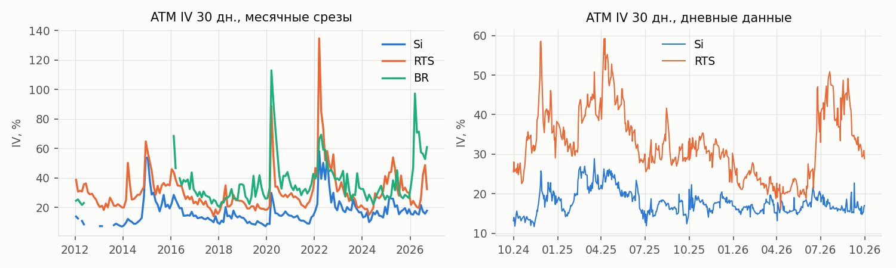
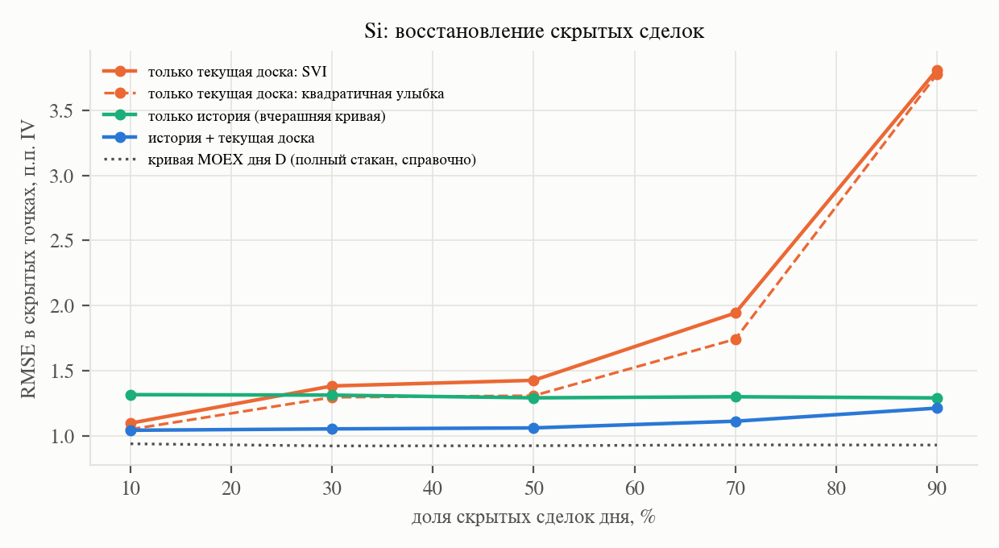

# Аудит данных MOEX и пилотная проверка гипотезы

*01.10.2026. Код: [`code/`](../code), таблицы: [`reports/tables/`](tables), графики: [`reports/figures/`](figures). Данные — бесплатный ISS Московской биржи.*

## Коротко

1. **Данных достаточно для работы, но не тех, что предполагались.** ISS бесплатно отдаёт итоги дня по каждому опциону (история с 2001 г., в аудите 2012–2026) и минутные свечи сделок по опционам и фьючерсам (проверено с 2013 г.). **Исторических bid/ask и стаканов нет** — только по подписке. Текущие лучшие котировки отдаются с задержкой ~15–20 мин, их можно копить самостоятельно.
2. **«Плотная» поверхность из расчётных цен — это модель биржи, а не рынок.** Расчётная цена каждого опциона считается по 6-параметрической кривой волатильности НКЦ. Кривая подстраивается по лучшим заявкам серии и стартует с вчерашних параметров. Формула НКЦ воспроизводит IV расчётных цен Si с медианной ошибкой 0.01 п.в. Цена есть у 100% листинга, включая страйки без сделок и открытого интереса. **Использовать её как истину для восстановления нельзя: это была бы проверка на модели биржи, а не на рынке.**
3. **Реальные наблюдения — сделки, и их мало.** Si — самый ликвидный актив: в рабочей зоне (|z| ≤ 2, 7–365 дней) медианно 325 точек в листинге и **66 OTM-точек со сделками (20%)**; серий с ≥ 5 точками — 3 из 7. RTS: 34 точки (23%). BR, GOLD, CNY, MIX — единицы–десятки точек в день: для основной части не годятся.
4. **IV сделок по дневной VWAP сильно зашумлена**: цена опциона усреднена за день, а F берётся на момент клиринга. Минутная синхронизация с фьючерсом снижает отклонение от биржевой кривой с 1.78 до 1.16 п.в. (RMS) и с 0.80 до 0.46 п.в. (медиана модуля).
5. **Пилот подтверждает гипотезу, но только при высокой разреженности.** На Si за год (254 дня, 21 217 сделок) скрывались реальные сделки:
   - при 10% скрытия история не помогает: методы текущей доски не хуже;
   - начиная с 30–50% метод «вчерашняя кривая + поправка по текущей доске» значимо лучше; при 90% RMSE 1.21 против 3.78 п.в.;
   - наивный перенос поправок между сериями ухудшает результат по сравнению с чистой историей. Связи между контрактами нужно моделировать структурно.
6. **Биржевая поверхность не согласована по срокам.** В ~¼ пар соседних серий Si полная дисперсия убывает по сроку (медианно нужно 2.3 п.в., чтобы исправить), в основном у неликвидных дальних серий. Это прямой аргумент за arbitrage-aware модель со связями между сериями.

**Рекомендация:** основной актив — Si, проверка переносимости — RTS. Целевые наблюдения — синхронизированные сделки (и собираемые с сегодняшнего дня bid/ask). Плотные биржевые кривые использовать как историю и признаки, но не как истину.

---

## 1. Что проверялось

Вопросы из приоритета №1 контекста диплома: какой базовый актив выбрать, какая история доступна, сколько серий и страйков в день, есть ли bid/ask, объём и открытый интерес, как плотность меняется во времени, есть ли надёжная цена фьючерса и **существует ли проблема разреженности на самом деле**.

## 2. Что отдаёт ISS

| Данные | Доступ | Комментарий |
|:---|:---|:---|
| Итоги дня по опционам (`history/.../options/securities`) | бесплатно, с 19.09.2001 | OHLC сделок, VWAP, объём, число сделок, открытый интерес, расчётная и теоретическая цены. Фильтр по `assetcode` работает |
| Описание контракта (`securities/{secid}`) | бесплатно | дата экспирации, базовый фьючерс, тип. В истории этих полей нет, берутся по одному запросу на серию |
| Итоги дня по фьючерсам | бесплатно | расчётная цена, VWAP, `SHORTNAME` для сопоставления с опционом |
| Минутные свечи опционов и фьючерсов (`.../candles`, `interval=1`) | бесплатно, проверено с 2013 г. | без поминутного оборота в рублях; время сделок восстанавливается с точностью до минуты |
| Текущие лучшие bid/ask (`marketdata`) | бесплатно, задержка ~15–20 мин | на 01.10.2026 22:11 двусторонние котировки у 384 из 982 опционов Si |
| Исторические bid/ask, стаканы, AlgoPack по срочному рынку | **только по подписке** | ISS отвечает «Информация доступна только подписчикам» |
| Поля `VOLAT`, `HIGHBID`, `LOWOFFER` в истории | заявлены в метаданных, но **не отдаются** | — |

Коды опционов разбираются однозначно (0 нераспознанных среди 1.84 млн строк). Премиальные европейские опционы с другими единицами страйка (например, `Si74.5CL6`) отфильтрованы.

## 3. Как устроена расчётная цена опциона

По [методике расчёта теоретической цены](https://www.moex.com/files/4mmzh8zwscm1yy2arrejhg0qwh) маржируемые опционы на фьючерсы оцениваются моделью Блэка без дисконтирования: `C = F·N(d1) − K·N(d2)`, `P = C + K − F`. Волатильность берётся из кривой НКЦ ([порядок расчёта кривых](https://www.moex.com/files/4j2v974rvh9c5y3b175b4s16w5)):

`σ = a + b·(1 − exp(−c·y²)) + d·arctg(e·y)/e`, где `x = ln(K/F)/√T`, `y = x − s/√T`.

Свойства этой кривой, существенные для диплома:

- калибруется **по лучшим активным заявкам** (с порогами по объёму и времени жизни), отдельно для каждой серии;
- начинает подстройку **с последних рассчитанных параметров**, то есть сама по себе history-aware;
- проверяется только монотонность цен по страйку. **Выпуклость (бабочка) и согласованность между сериями (календарь) не проверяются.**

Проверка на данных (Si и RTS, 2024-10 – 2026-09):

| Проверка | Si | RTS |
|:---|---:|---:|
| F по паритету колл–пут vs расчётная цена фьючерса, медиана / 99-й перцентиль отн. ошибки | 0 / 0 | 0 / 0 |
| Подгонка формулы НКЦ к IV расчётных цен, медианный RMSE, п.в. (90-й перцентиль) | 0.011 (0.068) | 0.040 (0.18) |
| Доля серий-дней с нарушением выпуклости сверх округления до шага цены | 2.2% | 2.5% |
| Доля пар соседних серий с календарным нарушением в зоне \|z\| ≤ 2 | 24% | 16% |
| Требуемый подъём IV дальней серии при нарушении, медиана / 90-й перцентиль, п.в. | 2.3 / 7.8 | 3.6 / 11.8 |

Модель Блэка с r = 0 описывает расчётные цены точно, F надёжно восстанавливается из самих опционов. Расчётная поверхность внутри серии — гладкий выход 6-параметрической модели, между сериями она часто несогласована. Пример: 27.03.2025 у серии Si на сентябрь (0 сделок за день) ATM IV 27.9%, у декабрьской (1 сделка) — 17.4%.

## 4. Выбор базового актива

Медианы по срезам в середине месяца за 2024-10 – 2026-09, рабочая зона |z| ≤ 2, 7–365 дней:

| Актив | Оборот 01.10.2026, млрд ₽ | Точек в листинге | С откр. интересом | Со сделками (OTM) | Покрытие | Серий с ≥ 5 сделками |
|:---|---:|---:|---:|---:|---:|---:|
| **Si** | 9.61 | 341 | 126 | **65** | 18% | 3 |
| **RTS** | 1.70 | 158 | 58 | **36** | 19% | 3 |
| BR | 0.84 | 172 | 37 | 20 | 11% | 1 |
| CNY | 0.10 | 126 | 31 | 12 | 10% | 1 |
| GOLD | 0.09 | 360 | 69 | 20 | 4% | 1 |
| MIX | 0.08 | 145 | 26 | 6 | 5% | 0 |



- **Si** — единственный актив, где на каждой доске есть несколько серий с осмысленным числом сделок; история плотная с ~2015 г.
- **RTS** — вторая площадка с той же структурой; полезна для проверки переносимости.
- **BR/GOLD/CNY/MIX** — доска почти пустая. Подходят только как стресс-тест «экстремальной разреженности». У MIX в 2017–2022 гг. сделок по OTM в зоне практически не было.

## 5. Насколько разрежена доска (дневные данные)

| Показатель (медиана, в скобках 10–90-й перцентили) | Si | RTS |
|:---|---:|---:|
| Серий в рабочей зоне | 7 (5–8) | 7 (5–8) |
| Точек в листинге в зоне | 325 (210–434) | 152 (83–247) |
| OTM-точек со сделками в зоне | 66 (51–84) | 34 (25–45) |
| Покрытие листинга сделками | 20% (15–33%) | 23% (14–38%) |
| Серий с ≥ 5 / ≥ 1 сделкой | 3 / 5 | 3 / 4 |
| Доля сегодняшних точек, торговавшихся вчера | 74% | 77% |
| Объём, контрактов в день | 63 838 | 18 874 |



Сделки сосредоточены в 2–3 ближних сериях около ATM. Дальние серии и крылья наблюдаются эпизодически, а 74–77% наблюдаемых точек повторяются изо дня в день. Разреженность реальная и структурированная: она зависит от срока и денежности, а не случайна.



## 6. Качество наблюдений: синхронизация сделок

IV, посчитанная по дневной VWAP опциона и F на момент клиринга, смещена: за день фьючерс Si проходит 1–2%, и около ATM ошибка достигает нескольких п.в. Поэтому IV считается по каждой минутной свече опциона с ценой фьючерса той же минуты и усредняется с весами объёма ([`ivs/intraday.py`](../code/ivs/intraday.py)). Учтено, что торговый день MOEX начинается с вечерней сессии предыдущего дня.

| Отклонение IV сделок от расчётной кривой дня (Si, 16 011 контракто-дней) | Дневная VWAP | Минутная синхронизация |
|:---|---:|---:|
| RMS, п.в. | 1.78 | 1.16 |
| Медиана модуля, п.в. | 0.80 | 0.46 |

Внутридневной разброс IV одного контракта — медианно 0.24 п.в. Это нижняя граница шума целевой переменной.



## 7. Режимы и динамика поверхности



В данных есть выраженные режимы: 2014–2015, март 2020, февраль–март 2022 (по RTS 15.03.2022 ATM IV > 100% при практически полном отсутствии сделок), а также всплески 2025–2026 гг.

Дневные изменения расчётной поверхности на сетке x = k/√T ∈ [−0.3, 0.3] × T ∈ {14, 30, 60, 90} дней:

| | Si | RTS |
|:---|---:|---:|
| Медиана модуля дневного изменения, вся сетка / ATM 30 дн., п.в. | 0.91 / 0.57 | 1.45 / 1.12 |
| RMS дневного изменения, п.в. | 3.18 | 3.74 |
| Доля дисперсии изменений, объяснённая 3 главными компонентами | 37 + 18 + 14 = 69% | 39 + 27 + 11 = 77% |
| Автокорреляция дневных изменений ATM 30 дн. | −0.31 | −0.04 |

Типичное дневное изменение (0.6–0.9 п.в.) сопоставимо с шумом сделок. Значит, вчерашняя поверхность — сильный априор, но с тяжёлыми хвостами: при скачках режима одна история ошибается. Отрицательная автокорреляция у Si указывает на шум в самих биржевых кривых. Доля общих факторов (69–77%) ниже, чем обычно на ликвидных рынках: неликвидные части поверхности двигаются «сами по себе».

## 8. Пилотная проверка гипотезы

**Постановка.** Si, 01.10.2025 – 30.09.2026, 254 дня. Наблюдения дня D — синхронизированные сделки по OTM-опционам: 3–180 дней, |k|/√T ≤ 0.6, медианно 83 точки и 5 серий в день. Удалены 102 грубые ошибки сделок (0.5%): |IV − IV расчётной кривой дня| > 5 п.в. Часть наблюдений скрывается и восстанавливается по остальным.

| Метод | Что использует |
|:---|:---|
| `cb_quad` | только текущая доска: квадратичная улыбка по x = k/√T в серии (ridge), для серий без точек — общая поверхность дня |
| `cb_svi` | только текущая доска: raw SVI (с ограничением Ли на крылья) при ≥ 5 точках в серии, иначе `cb_quad` |
| `hist` | только история: вчерашняя расчётная кривая той же серии (sticky moneyness) |
| `hist_cb` | вчерашняя кривая + байесовская поправка уровня/наклона/серии по видимым точкам (масштабы априора заданы заранее, не подбирались) |
| `moex_today` | расчётная кривая дня D — построена по полному стакану дня D, **справочно, не конкурент** |

**Результаты** (RMSE / MAE в скрытых точках, п.в.):

| Скрытие | `hist` | `cb_quad` | `cb_svi` | `hist_cb` | `moex_today` |
|:---|---:|---:|---:|---:|---:|
| случайно 10% | 1.32 / 0.85 | 1.05 / 0.61 | 1.10 / **0.60** | **1.04** / 0.68 | 0.94 / 0.66 |
| случайно 30% | 1.31 / 0.84 | 1.30 / **0.66** | 1.38 / **0.66** | **1.06** / 0.68 | 0.92 / 0.65 |
| случайно 50% | 1.29 / 0.84 | 1.31 / 0.70 | 1.43 / 0.72 | **1.06 / 0.69** | 0.93 / 0.65 |
| случайно 70% | 1.30 / 0.84 | 1.74 / 0.88 | 1.94 / 0.97 | **1.11 / 0.71** | 0.93 / 0.65 |
| случайно 90% | 1.29 / 0.84 | 3.78 / 2.09 | 3.81 / 2.12 | **1.21 / 0.79** | 0.93 / 0.65 |
| крылья (\|z\| > 1), видно только ATM | 1.38 / 0.92 | 3.12 / 1.87 | 4.30 / 2.78 | **1.33 / 0.89** | 0.98 / 0.70 |
| целая серия | **1.28 / 0.83** | 1.96 / 1.39 | 1.96 / 1.39 | 1.39 / 0.98 | 0.92 / 0.64 |

Разность RMSE `hist_cb` − лучший из `cb_*`, 95% бутстреп-интервал по дням: при 10% — −0.01 [−0.10; 0.08] (различия нет); при 50% — −0.25 [−0.33; −0.16]; при 90% — −2.56 [−2.81; −2.36]; на крыльях — −1.78 [−2.02; −1.54]. `hist_cb` лучше чистой истории при 10–50% скрытия на 0.23–0.27 п.в., но при скрытии целой серии хуже её на 0.11 [0.08; 0.14].



RMSE по числу видимых точек в той же серии:

| Видимых точек в серии | 0 | 1–2 | 3–4 | 5–9 | 10+ |
|:---|---:|---:|---:|---:|---:|
| `cb_quad` | 3.08 | 4.70 | 2.83 | 1.32 | **0.80** |
| `hist` | **2.07** | 1.56 | 1.25 | 1.26 | 1.02 |
| `hist_cb` | 2.11 | **1.39** | **1.09** | **1.02** | 0.83 |

**Что это значит для гипотезы.**

- **Подтверждается:** ценность истории растёт с разреженностью. Граница — около 10 видимых сделок в серии. Ниже неё методы только текущей доски проигрывают в разы, выше история не нужна. На реальной доске Si полно серий ниже этой границы (см. п. 5), так что эффект практически значим.
- **Не подтверждается в наивной форме:** «связи между контрактами» в виде общей поправки для всех серий вредят, когда серия скрыта целиком. Короткие и длинные серии двигаются по-разному, перенос нужно моделировать через структуру по сроку (факторы, SSVI-подобная связь, граф серий), а не одним сдвигом.
- `hist_cb` при 10–50% скрытия почти достигает кривой биржи дня D, построенной по полному стакану (1.04–1.06 против 0.92–0.94 п.в. RMSE). При этом он видит только сделки и вчерашнюю кривую.

**Ограничения пилота.** Простые модели; среди базовых методов нет SSVI и безарбитражных сплайнов. Один актив и один год. Скрытие случайное внутри дня, без проверки прогноза на t+h. Априор `hist_cb` — расчётная кривая биржи, которая сама построена по вчерашнему стакану. Это законная информация на момент t, но не «чистая» история сделок. Фильтр грубых ошибок использует кривую дня D, что слегка благоприятствует `moex_today`.

## 9. Что это меняет в методологии

1. **Целевая переменная** — синхронизированные по минутам сделки, позже дополненные собираемыми bid/ask. Расчётные цены — вход (история, априор, признаки), но не истина. Иначе работа превратится в восстановление 6-параметрической кривой НКЦ.
2. **Основной актив — Si**, проверка переносимости — RTS. BR/GOLD/CNY/MIX — только как стресс-тест экстремальной разреженности.
3. **Схемы скрытия** должны повторять реальную структуру пропусков: крылья, целая серия, дальние сроки. Случайное скрытие при 10% почти не отличает методы.
4. **Сильные базовые методы обязательны**: SSVI и безарбитражные сплайны по текущей доске, а также `hist` и `hist_cb` как простые history-aware базовые методы. Новая модель должна побеждать `hist_cb`, а не только SVI.
5. **Связи между сериями** — главный открытый вопрос: наивное объединение не работает, нужна модель структуры по сроку. Тот же вопрос — у арбитража: биржевая поверхность часто нарушает календарное условие.
6. **Режимы**: история с 2013 г. (минутные свечи) покрывает 2014, 2020 и 2022 гг. Хронологическое разбиение должно включать хотя бы один кризисный период в тест.
7. **Сбор bid/ask начать сейчас**: [`collect_live_board.py`](../code/scripts/collect_live_board.py) по cron. К весне 2027 г. будет около полугода собственных котировок для проверки попадания в bid–ask.

## 10. Как воспроизвести

См. [`code/README.md`](../code/README.md). Полный цикл (загрузка ~20 мин, кэш ~100 МБ, синхронизация года Si ~13 мин, пилот ~15 мин на 14 ядрах):

```bash
python code/scripts/download_moex.py --data-dir data --monthly 2012-01:2026-09 \
    --monthly-assets Si RTS BR MIX GOLD CNY --daily 2024-10-01:2026-09-30 --daily-assets Si RTS
python code/scripts/audit_moex.py --data-dir data --out reports
python code/main.py   # пилот: данные, синхронизация, восстановление, таблицы, рисунки
```
